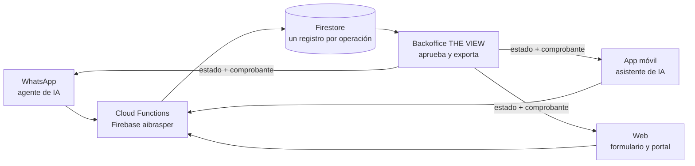

# BRASPER-IATHON

**Una remesa. Un registro. Todo el sistema.** Repositorio paraguas del equipo **5.5** para IATHON Perú 2026, reto *Agilidad en el proceso de venta y facturación de remesas* de BrasPer.

No duplica código: cada carpeta es un **submódulo** que apunta al repositorio público donde vive esa pieza.

## La solución

Hoy cada remesa pasa por cuatro pasos manuales (negociar por WhatsApp, digitar en el Dashboard, validar el pago y exportar/importar) y el mismo dato vive en dos lugares. La propuesta: **tres canales que crean el mismo registro, y un solo Backoffice que lo aprueba.**



Cada operación nace como un registro (p. ej. `BR-0001`) y avanza por `pending → validating → approved → exported`. Las reglas de dinero (tasa, comisión, totales) viven en el código, no en el prompt de la IA, y una asesora aprueba cada operación.

## Piezas

| Carpeta | Responsable | Qué es | Repositorio |
|---|---|---|---|
| [`app/`](app) | Binni | App Expo (iOS, Android, web), asistente de IA con LangGraph, Cloud Functions y reglas de Firebase | [binnicordova/iathon-fintech](https://github.com/binnicordova/iathon-fintech) |
| [`web/`](web) | Jordy | Sitio web y portal de transferencias sobre las Cloud Functions (Lovable) | [jordyalania/brasper-global-connect](https://github.com/jordyalania/brasper-global-connect) |
| [`backoffice/`](backoffice) | Melani | THE VIEW: valida, exporta y factura las operaciones de todos los canales | [Melani232000/the-view](https://github.com/Melani232000/the-view) |
| [`whatsapp-agent/`](whatsapp-agent) | David | Agente de WhatsApp: flujo de cotización, datos, pago y estado (Kapso) | [davidrodriguez2712/iaton-proyecto](https://github.com/davidrodriguez2712/iaton-proyecto) |

> `whatsapp-agent/` sigue la rama `feat/brasper-whatsapp-kapso`, que es la rama por defecto de ese repositorio.

## Probar la demo

- App Android (APK y QR): https://binnicordova.github.io/iathon-fintech/app/
- Plan del producto y análisis: https://binnicordova.github.io/iathon-fintech/
- Todos los datos, tasas y cuentas son de demostración; la facturación corre en modo prueba.

## Instalación

Requisitos: Git, Node.js 22 o superior, [Bun](https://bun.sh) (solo para la app) y, para correr el backend en local, la [Firebase CLI](https://firebase.google.com/docs/cli).

```bash
git clone --recurse-submodules https://github.com/binnicordova/BRASPER-IATHON.git
cd BRASPER-IATHON
# si ya clonaste sin submódulos:
git submodule update --init --recursive
```

## Ejecución de cada pieza

Todas usan el proyecto Firebase `aibrasper` ya desplegado. Copia `.env.example` de cada carpeta a su archivo de entorno cuando lo pida (la lista completa está en [`.env.example`](.env.example)).

| Pieza | Comandos | Notas |
|---|---|---|
| App | `cd app && bun install && bun run start` | Pulsa `w` (web), `i` (simulador iOS) o escanea el QR con Expo Go (SDK 57). No necesita variables para correr. Asistente en modo básico si no hay crédito de Gemini. |
| Web | `cd web && npm install && npm run dev` | Pruebas: `npm test`. La config pública de Firebase ya viene en `src/lib/api/config.ts`. |
| Backoffice | `cd backoffice && cp .env.example .env && npm install && npm start` | Rellena `.env` con la config web de Firebase. Los usuarios de equipo se crean con `npm run grant-staff`. |
| Agente de WhatsApp | `cd whatsapp-agent/kapso && node --test && node build/emit.js` | Genera los workflows de Kapso en `dist/`. Los pasos de publicación y de demo están en `whatsapp-agent/kapso/README.md`. |

Backend local sin tocar producción (desde `app/`): `bun run functions:install && bun run emulators`.

## Actualizar los submódulos

Este repositorio guarda un commit fijo de cada pieza. Para traer lo último de cada repositorio:

```bash
git submodule update --remote
git add -A && git commit -m "chore: update submodules"
```

## Equipo

**5.5**: David (agente de WhatsApp), Binni (app), Jordy (web) y Melani (backoffice).

## Licencia

Ver [license](license). Cada submódulo conserva la suya.
