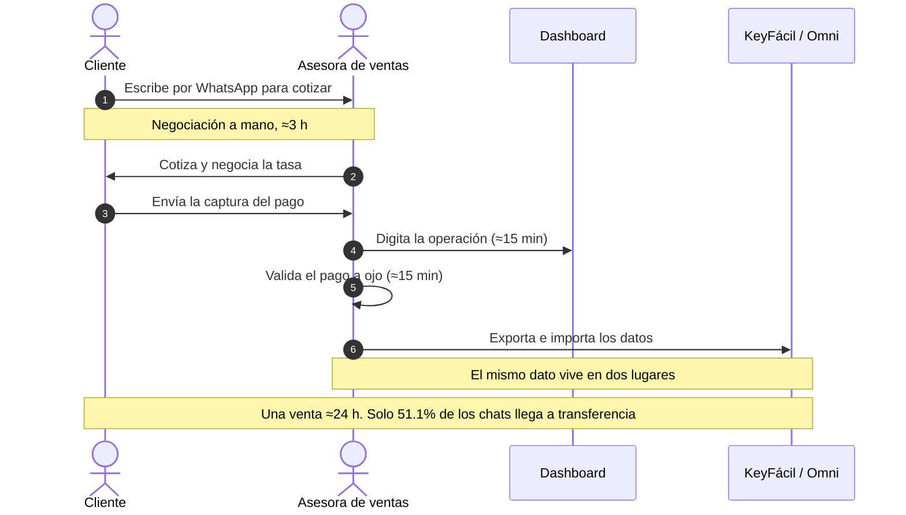
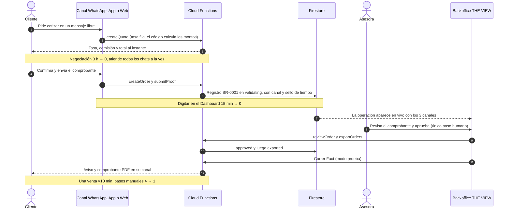
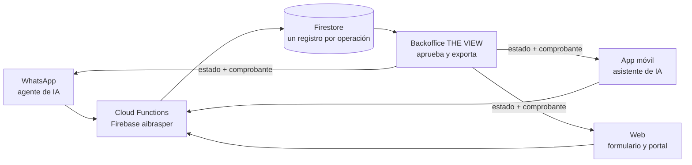

# BRASPER-IATHON

**Una remesa. Un registro. Todo el sistema.** Repositorio paraguas del equipo **5.5** para IATHON Perú 2026, reto *Agilidad en el proceso de venta y facturación de remesas* de BrasPer.

No duplica código: cada carpeta es un **submódulo** que apunta al repositorio público donde vive esa pieza.

## El objetivo: que BrasPer venda más remesas con el mismo equipo

BrasPer ya crece (3,776 envíos en el 2T 2026, +24.7%), pero el proceso de venta sigue a mano. De unos 131 chats diarios en WhatsApp solo 67 (51.1%) terminan en transferencia; los otros 64 se quedan en cotización. Cada venta pasa por cuatro pasos manuales y el mismo dato vive en dos lugares, así que **atender más chats exige sumar vendedores**.

Nuestra propuesta ataca ese cuello de botella: la conversación y el registro los hace la IA, y la persona solo hace lo que debe hacer una persona, aprobar el pago.

### Hoy (AS IS): cada venta depende de una asesora de principio a fin



### Con BRASPER-IATHON (TO BE): la IA conversa y registra, la asesora solo aprueba



| Indicador | AS IS | TO BE |
|---|---|---|
| Tiempo de negociación | ≈3 h | 0 (cotiza la IA) |
| Digitar en el Dashboard | ≈15 min | 0 (el registro nace digital) |
| Pasos manuales por venta | 4 | 1 (aprobar) |
| Tiempo de una venta | ≈24 h | ≈10 min |
| Costo mensual | ≈S/6,800 (4 vendedores) | ≈S/300 operar la solución |
| ¿Se puede medir la venta? | No (solo `created_at`) | Sí, con estado, canal y sello de tiempo |

Los tiempos del TO BE y los costos son estimaciones del equipo, por validar con BrasPer. La solución no reemplaza a las asesoras: ellas siguen aprobando cada operación, y los datos y montos del MVP son de demostración.

## Arquitectura



Cada operación nace como un registro (p. ej. `BR-0001`) y avanza por `pending → validating → approved → exported`. Las reglas de dinero (tasa, comisión, totales) viven en el código, no en el prompt de la IA.

## Piezas

| Carpeta | Responsable | Qué es | Repositorio |
|---|---|---|---|
| [`app/`](app) | Binni | App Expo (iOS, Android, web), asistente de IA con LangGraph, Cloud Functions y reglas de Firebase | [binnicordova/iathon-fintech](https://github.com/binnicordova/iathon-fintech) |
| [`web/`](web) | Jordy | Sitio web y portal de transferencias sobre las Cloud Functions (Lovable) | [jordyalania/brasper-global-connect](https://github.com/jordyalania/brasper-global-connect) |
| [`backoffice/`](backoffice) | Melani | THE VIEW: valida, exporta y factura las operaciones de todos los canales | [Melani232000/the-view](https://github.com/Melani232000/the-view) |
| [`whatsapp-agent/`](whatsapp-agent) | David | Agente de WhatsApp sobre WAHA con Claude Haiku y el backend real de Firebase (`waha/`), más un prototipo en Kapso (`kapso/`) | [davidrodriguez2712/iaton-proyecto](https://github.com/davidrodriguez2712/iaton-proyecto) |

> Los 4 submódulos siguen la rama `main` de su repositorio (ver `.gitmodules`). Para traer lo último: `npm run sync`.

Cada pieza trae su propio `.env.example`: [`app/.env.example`](app/.env.example), [`web/.env.example`](web/.env.example), [`backoffice/.env.example`](backoffice/.env.example) y [`whatsapp-agent/waha/.env.example`](whatsapp-agent/waha/.env.example). Ninguno lleva claves privadas.

## Probar la demo

- App Android (APK y QR): https://binnicordova.github.io/iathon-fintech/app/
- Plan del producto y análisis: https://binnicordova.github.io/iathon-fintech/
- Todos los datos, tasas y cuentas son de demostración; la facturación corre en modo prueba.

## Instalación

Requisitos: Git, Node.js 24 o superior, [Bun](https://bun.sh) (solo para la app), Docker (solo para el bot de WhatsApp) y, para correr el backend en local, la [Firebase CLI](https://firebase.google.com/docs/cli).

```bash
git clone --recurse-submodules https://github.com/binnicordova/BRASPER-IATHON.git
cd BRASPER-IATHON
# si ya clonaste sin submódulos:
git submodule update --init --recursive
```

## Ejecución de cada pieza

Todas usan el proyecto Firebase `aibrasper` ya desplegado. Copia el `.env.example` de cada carpeta a su archivo de entorno cuando lo pida.

| Pieza | Comandos | Notas |
|---|---|---|
| App | `cd app && bun install && bun run start` | Pulsa `w` (web), `i` (simulador iOS) o escanea el QR con Expo Go (SDK 57). No necesita variables para correr. El asistente pasa a modo básico si no hay crédito de Gemini. |
| Web | `cd web && npm install && npm run dev` | Pruebas: `npm test`. La config pública de Firebase ya viene en `src/lib/api/config.ts`. |
| Backoffice | `cd backoffice && cp .env.example .env && npm install && npm start` | Rellena `.env` con la config web de Firebase. Los usuarios de equipo se crean con `npm run grant-staff`. |
| Agente de WhatsApp | `cd whatsapp-agent/waha && npm run setup && docker compose up -d waha && npm run sesion && npm start` | Escanea el QR en `http://127.0.0.1:3010/dashboard` con un número dedicado. `ANTHROPIC_API_KEY` va en el `.env`; sin ella el flujo pregunta paso a paso. Con `BACKEND=real` usa Firebase. Detalles en `whatsapp-agent/waha/README.md`. |

Backend local sin tocar producción (desde `app/`): `bun run functions:install && bun run emulators`.

## Actualizar los submódulos

Este repositorio guarda un commit fijo de cada pieza. Para traer lo último de cada repositorio:

```bash
git submodule update --remote
git add -A && git commit -m "chore: update submodules"
```

## Equipo

**5.5**: David (agente de WhatsApp), Binni (app), Jordy (web) y Melani (backoffice).

## Licencia

Ver [license](license). Cada submódulo conserva la suya.
